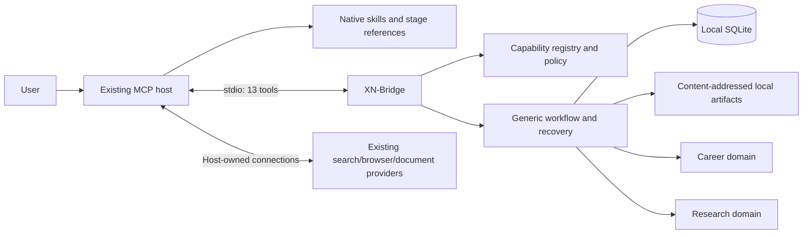

# Architecture

The host interprets user intent and activates skills. XN-Bridge proposes deterministic routing and persists coordination state. The host discovers and executes sibling tools using its existing connections and permission mechanisms. Results return as evidence and execution records before the next checkpoint.

`server.py` supplies validated MCP inputs and compact structured responses. `hosts.py` adapts Codex/Claude configuration; `discovery.py` is an explicit operator audit client, not a runtime gateway. `registry.py` resolves allowlisted capability mappings against observed tools. `routing.py` handles rules and optional local classification. `workflow.py`, `executions.py`, `evidence.py`, `approval.py`, and `store.py` own local records and transaction boundaries. `domains/` contains independent domain actions and stage contracts. SQLite contains no career-specific tables: domain entities use typed records in a generic entity table.

The only bridge-side public fetch is a bounded adapter for three structured ATS boards. It supplies normalized, evidence-addressed board records where the existing search tools provide discovery but do not guarantee the required exact board contract. It is not a general scraper or search engine. All browser automation, PDF extraction and PDF generation remain existing-provider responsibilities.

Trust boundaries: external pages/tool output are untrusted data; source records do not grant permissions. Capability mappings are local configuration. Approval signatures gate bridge execution bookkeeping only. The host can invoke sibling tools directly, so real submissions remain manual when host approval enforcement cannot be established. Neither a model nor a manifest can fix that boundary. Raw artifacts are private local files, not original evidence of authenticity merely because a digest exists.

The server starts and stops with the host's stdio session; it opens no TCP port. No cloud infrastructure, second orchestration framework, model daemon, dashboard or proxy was added. Optional Ollama classification uses the pre-existing loopback runner and is disabled by default.

The continuation adds `host_api.py` / `host_catalog.py`: a short-lived inventory adapter uses installed Codex app-server connections and startup events, with bounded targeted polling when tool-list notifications are unavailable. It performs no inference or workflow orchestration. CLI-only full backup/restore in `backup.py` packages SQLite, referenced artifacts, local configuration and encrypted approval keys into a verified archive; restoration to a new home revokes old grants and requires reconciliation for uncertain external attempts.

Two isolated stdio providers fill verified integration gaps: public-board discovery and Gmail readonly. `scripts/gmail_stdio.py` is a small launcher that fixes callback Host/Origin validation and strict state defaults while retaining upstream OAuth logic. The callback HTTP listener is on-demand loopback only, for Google's browser redirect; no OAuth account is connected yet. [Provider scope and evidence](mcp-integrations.md) distinguish installation, initialization and actual business acceptance.
