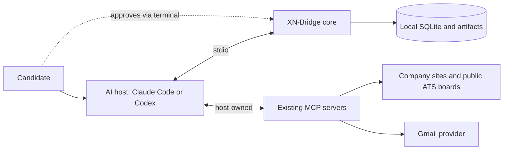
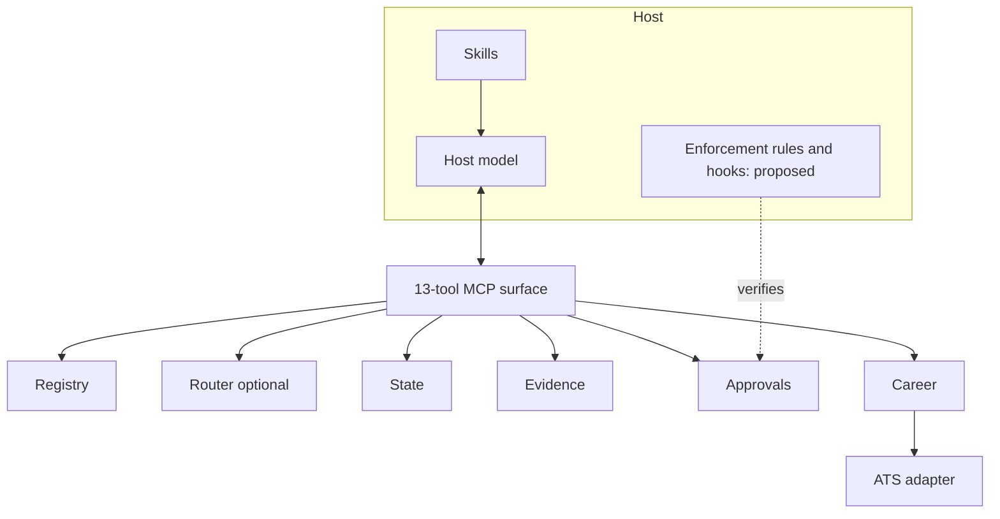
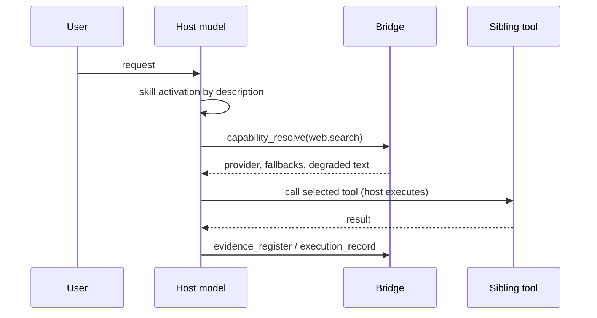
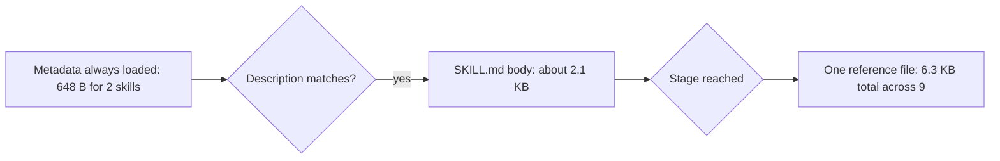
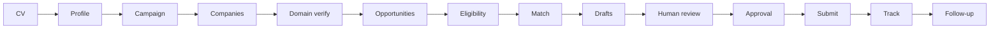
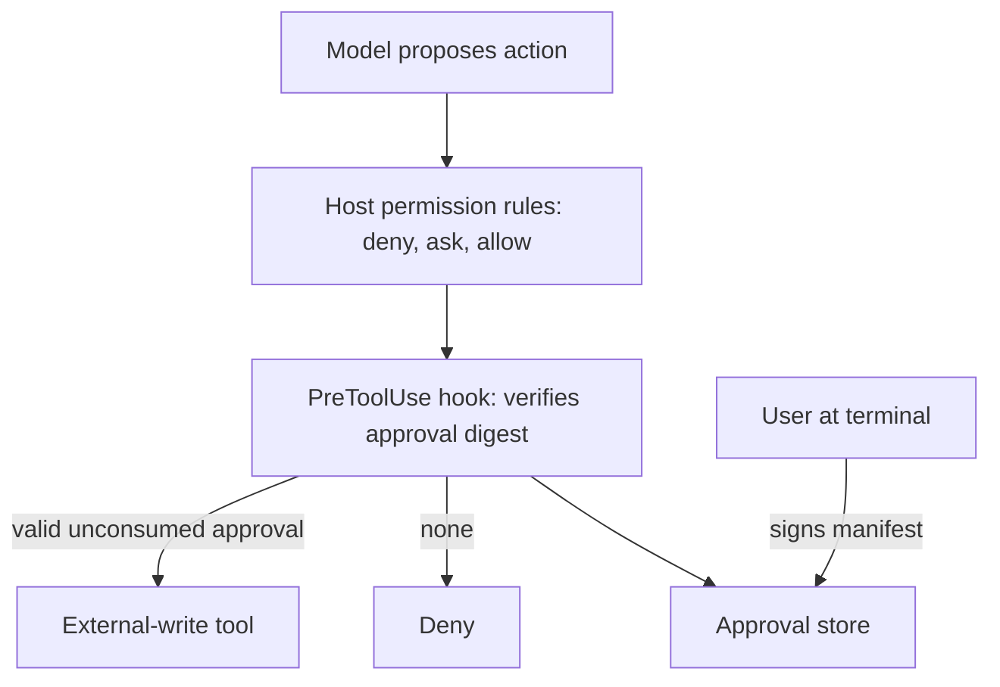
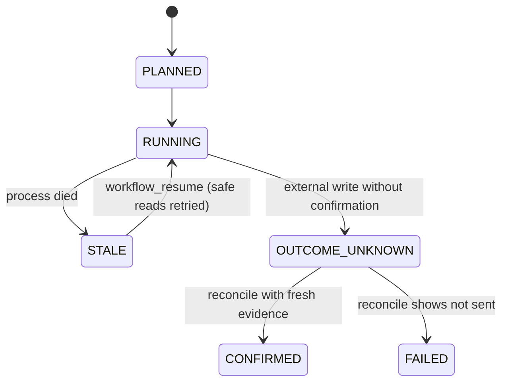
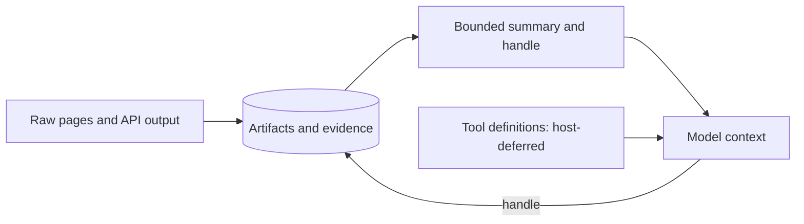

# 05 — Target System Architecture (v2)

Verified 2026-11-17. Components are logical, not mandated services. Evidence: R1 (source), R3 (tool surface), W1 to W6.

## 1. Components and responsibilities

| ID | Component | Responsibility | Exists | Traces to |
|---|---|---|---|---|
| C1 | State engine (`store`, `workflow`, `executions`) | Workflows, stages, checkpoints, write-ahead execution records, recovery | Yes | FR-REC, FR-TRK |
| C2 | Evidence manager (`evidence`, `artifacts`) | Content-addressed raw capture, provenance, freshness, injection flags | Yes | FR-OPP, FR-CV |
| C3 | Approval service (`approval`, `security`) | Payload-bound single-use Ed25519 approvals; human CLI | Yes | FR-APR-001, FR-APR-002 |
| C4 | Capability registry (`registry`, `capabilities.toml`, `policy.toml`) | Logical capability to provider mapping, health, contract hashes, risk labels | Yes | FR-CAP, FR-BRG-002 |
| C5 | Intent router (`routing`) | Deterministic intent hints with escalation | Yes, optional | FR-BRG-003 |
| C6 | Career domain (`domains/career`) | Profile, campaign, companies, opportunities, matching, drafts, submission manifests | Yes | FR-CAR to FR-TRK |
| C7 | ATS adapter (`career/ats`) | Bounded read of Greenhouse, Lever, Ashby | Yes | FR-OPP-002 |
| C8 | Skills suite (`skills/`) | Entry skill, career skill, 9 lazy references | Yes | FR-SKL |
| C9 | Host adapters and discovery (`hosts`, `host_api`, `host_catalog`, `discovery`) | Operator audit of providers; Codex inventory | Yes, Codex-tested | FR-CAP-001 |
| C10 | Backup and restore | Full-state archive; restore revokes grants | Yes | FR-REC |
| C11 | Research domain | Second domain proving the core is generic | Yes | none in the Must set (see doc 12) |
| C12 | Host enforcement layer | Deny external-write tools that lack a valid approval | **No** | FR-APR-003 |
| X | Existing providers | Search, browser, documents, mail | Yes, reused | FR-INT-001 |

Responsibility ownership (one owner each):

| Question | Owner |
|---|---|
| Who discovers tools? | Host (native); C9 only for operator audit |
| Who selects a tool? | Host model, guided by skill and C4 resolution output |
| Who connects to sibling servers? | Host |
| Who validates sibling arguments? | Host |
| Who enforces permission? | Host rules and hooks (C12, proposed). C3 records and verifies approvals but cannot stop a direct call |
| Who handles credentials? | The provider that owns them (Gmail OAuth lives in the Gmail provider) |
| Who stores workflow state? | C1 |
| Who normalizes results? | C2 and C6 |
| Who verifies success? | Host reports; C1 requires confirmation evidence, else OUTCOME_UNKNOWN |
| Who records side effects? | C1 `execution_record` |

## 2. Diagram A — System context

## 3. Diagram B — Logical components

## 4. Diagram C — Dynamic tool selection

## 5. Diagram D — Skill activation

## 6. Diagram E — Career workflow

## 7. Diagram F — Authorization boundary (target)

The model never grants. The user signs outside the model's tool surface. The hook and rules run in the host process, not in the model.

## 8. Diagram G — Failure recovery

## 9. Diagram H — Context and token flow

Processed outside model context: dedup, status and eligibility checks, matching, TTL checks, digest checks. Inside: summaries, drafts, decisions.

## 10. Architectural fitness functions

| Function | Threshold | Source |
|---|---|---|
| Bridge tool definition size | under 5,000 est. tokens | NFR-PER-003 |
| Always-on project skill metadata | under 300 est. tokens | NFR-PER-004 |
| No sibling call path in bridge runtime code | zero matches | FR-BRG-001 |
| Direct fixture send without approval | denied | FR-APR-003 |
| Listening sockets of the bridge process | zero | existing test |
